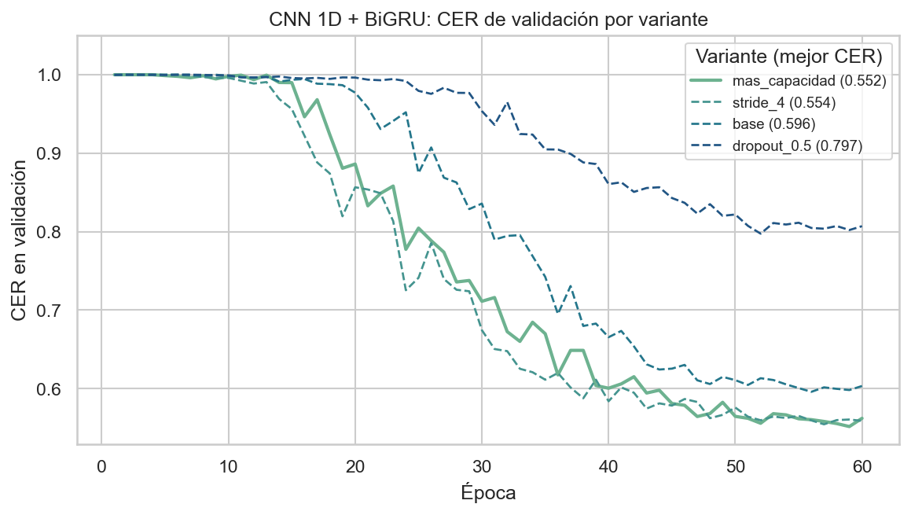
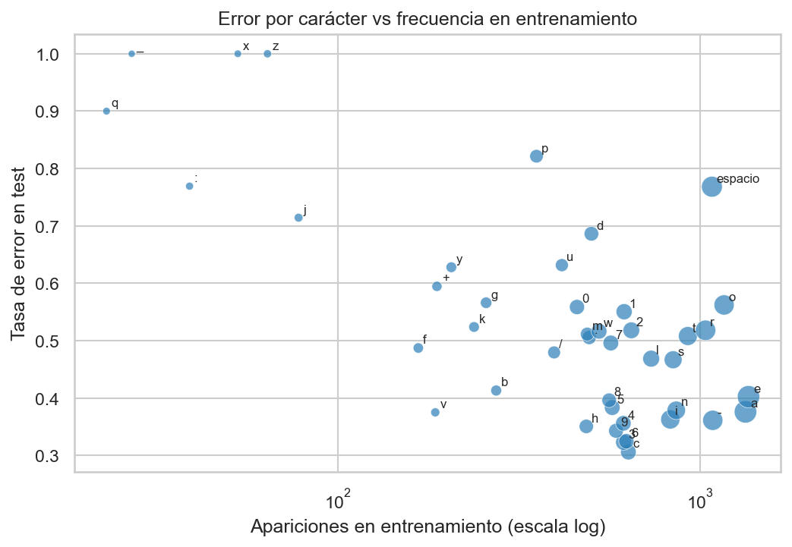

# Modelo principal: CNN 1D + BiGRU + CTC

**Responsable principal:** Leonardo Mejía

> Sección del informe final para el modelo principal. Alimenta la Metodología (selección y arquitectura)
> y los Resultados (ajuste de parámetros y desempeño). Detalle y código en
> [notebooks/07_modelo_cnn_bigru.ipynb](../notebooks/07_modelo_cnn_bigru.ipynb).

## Por qué se eligió

La revisión bibliográfica comparó CNN, LSTM, BiLSTM, GRU y Transformers, y concluyó que para transcribir
deletreo manual desde *landmarks* lo que más pesa es combinar un extractor local, un modelo con contexto de
ambos lados y una pérdida que no exija alineación. El modelo principal reúne las tres cosas, y cada parte
responde a un hallazgo del análisis exploratorio:

| Hallazgo del EDA | Decisión de diseño | Fuente |
|------------------|--------------------|--------|
| Secuencias con mediana de 147 cuadros y cola hasta ~750 | CNN 1D con *stride* que acorta la secuencia antes de la parte recurrente | Bai et al. (2018) |
| Las letras se distinguen por movimientos de pocos cuadros | Filtros convolucionales de 5 cuadros sobre el eje del tiempo | LeCun et al. (1998) |
| Coarticulación y letras parecidas (M, N, T) | GRU bidireccional: cada letra se decide con contexto anterior y posterior | Schuster y Paliwal (1997) |
| Solo 1,315 secuencias de entrenamiento y cómputo en CPU | GRU en lugar de LSTM: desempeño comparable con menos parámetros | Cho et al. (2014); Chung et al. (2014) |
| La etiqueta es la frase completa, sin alineación cuadro-letra | Pérdida CTC | Graves et al. (2006) |
| Mano derecha ausente en ~54.5 % de los cuadros | Máscara de detección como entrada adicional | Avance 1 |

Es la misma estructura de HandReader, que con *landmarks* de MediaPipe alcanzó 69.3 % de exactitud por letra
en ChicagoFSWild (Korotaev et al., 2025).

## Arquitectura

Cada cuadro entra como un vector de 227 valores: 21 puntos por mano centrados en la muñeca, 33 puntos de pose
centrados en los hombros (cada uno con x, y, z) y dos indicadores de si cada mano fue detectada. El modelo
aplica dos bloques convolucionales sobre el tiempo (el primero con *stride* 2, que reduce la secuencia a la
mitad), cada uno con normalización por lotes, activación GELU y *dropout*; luego una GRU bidireccional de dos
capas y una capa lineal que da la probabilidad de cada uno de los 59 caracteres más el *blank* de CTC en cada
cuadro. La frase se obtiene con decodificación *greedy*: el carácter más probable por cuadro, colapsando
repeticiones y quitando los *blanks*.

Antes de entrenar se verificó qué tanto se puede reducir el tiempo: CTC necesita al menos tantos cuadros de
salida como letras tiene la frase. Con *stride* 2 sigue siendo alineable el 95.5 % de las secuencias de
entrenamiento y con *stride* 4 el 92.5 %; con 6 baja a 84.1 %.

## Entrenamiento y ajuste de parámetros

Todas las corridas usan los mismos datos, el split por participante (64 / 14 / 14 personas), la semilla 42,
el optimizador AdamW con tasa de aprendizaje de 0.003 en un ciclo (*one-cycle*), recorte de gradiente y
*early stopping* por CER de validación, durante un máximo de 60 épocas. Se cambió un hiperparámetro a la vez
respecto a una configuración base:

| Variante | Cambio | Parámetros | CER validación | Tiempo (min) |
|----------|--------|-----------:|---------------:|-------------:|
| mas_capacidad | 256 canales, 192 unidades GRU | 1,696,060 | **0.552** | 47.7 |
| stride_4 | *stride* 4 | 888,828 | 0.554 | 14.8 |
| base | 192 canales, 128 unidades, *stride* 2, *dropout* 0.3 | 888,828 | 0.596 | 48.4 |
| dropout_0.5 | *dropout* 0.5 | 888,828 | 0.797 | 33.1 |

Más capacidad mejoró el resultado; reducir más el tiempo con *stride* 4 dio prácticamente el mismo CER en un
tercio del tiempo; y un *dropout* de 0.5 frenó el aprendizaje. Ninguna variante se detuvo antes de la época 60,
así que todas seguían mejorando. Se eligió la variante de mayor capacidad por su menor CER de validación; el
conjunto de prueba solo se usó al final.

## Resultados en prueba

| Métrica | Valor |
|---------|------:|
| CER en prueba | 0.490 |
| Métrica de Kaggle (1 − CER) | 0.510 |
| CER en validación | 0.552 |
| Tiempo de entrenamiento (CPU) | 47.7 min |
| Tiempo de predicción | 5.3 ms por secuencia |

El modelo transcribe correctamente alrededor del 51 % de los caracteres de personas que no vio durante el
entrenamiento. El análisis de errores conecta el resultado con el EDA:

- **Faltantes de mano:** la cobertura de mano de cada secuencia es lo que más explica su error (correlación de
  Spearman de −0.72 con el CER).
- **Desbalance de caracteres:** los caracteres poco frecuentes en entrenamiento se fallan más (Spearman de −0.53
  entre frecuencia y tasa de error); q, x y z se fallan casi siempre.
- **Velocidad de deletreo:** el cuartil de secuencias más rápidas tiene CER de 0.655, contra 0.400 del más lento.
- **Tipo de error:** el 76 % de los errores son letras omitidas, sobre todo espacios y letras frecuentes; solo
  el 22 % son sustituciones de una letra por otra.

El resultado está por debajo de lo reportado en la literatura, pero no es directamente comparable: HandReader y
la solución ganadora de la competencia (Henkel, 2023) usaron conjuntos mucho mayores, mientras que aquí se
entrenó con 1,315 secuencias. Las mejoras más directas son aumentar los datos (aumentación y más archivos de la
competencia) y entrenar más épocas.

## Referencias

Bai, S., Kolter, J. Z., & Koltun, V. (2018). *An empirical evaluation of generic convolutional and recurrent networks for sequence modeling*. arXiv. https://arxiv.org/abs/1803.01271

Cho, K., van Merriënboer, B., Gulcehre, C., Bahdanau, D., Bougares, F., Schwenk, H., & Bengio, Y. (2014). Learning phrase representations using RNN encoder–decoder for statistical machine translation. In *Proceedings of the 2014 Conference on Empirical Methods in Natural Language Processing* (pp. 1724–1734). Association for Computational Linguistics. https://aclanthology.org/D14-1179

Chung, J., Gulcehre, C., Cho, K., & Bengio, Y. (2014). *Empirical evaluation of gated recurrent neural networks on sequence modeling*. arXiv. https://arxiv.org/abs/1412.3555

Graves, A., Fernández, S., Gomez, F., & Schmidhuber, J. (2006). Connectionist temporal classification: Labelling unsegmented sequence data with recurrent neural networks. In *Proceedings of the 23rd International Conference on Machine Learning* (pp. 369–376). https://www.cs.toronto.edu/~graves/icml_2006.pdf

Henkel, C. (2023). *1st place solution to the Google – American Sign Language Fingerspelling Recognition competition* [Repositorio de código]. GitHub. https://github.com/ChristofHenkel/kaggle-asl-fingerspelling-1st-place-solution

Korotaev, P., Surovtsev, P., Kapitanov, A., Kvanchiani, K., & Nagaev, A. (2025). *HandReader: Advanced techniques for efficient fingerspelling recognition*. arXiv. https://arxiv.org/abs/2505.10267

LeCun, Y., Bottou, L., Bengio, Y., & Haffner, P. (1998). Gradient-based learning applied to document recognition. *Proceedings of the IEEE, 86*(11), 2278–2324. https://doi.org/10.1109/5.726791

Schuster, M., & Paliwal, K. K. (1997). Bidirectional recurrent neural networks. *IEEE Transactions on Signal Processing, 45*(11), 2673–2681. https://doi.org/10.1109/78.650093
