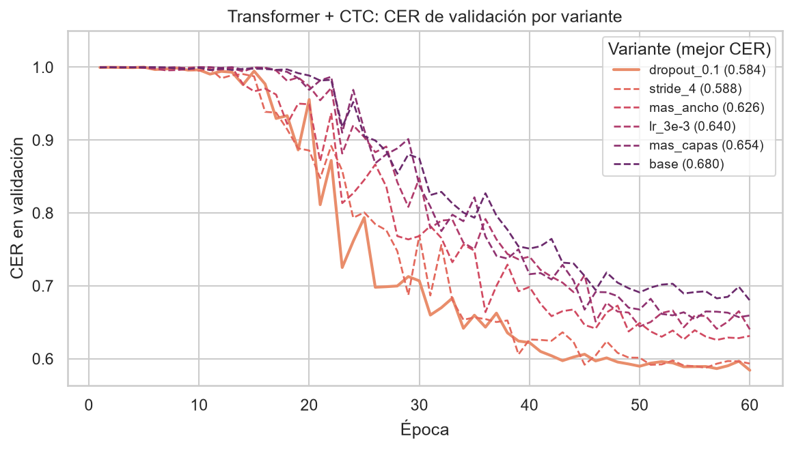
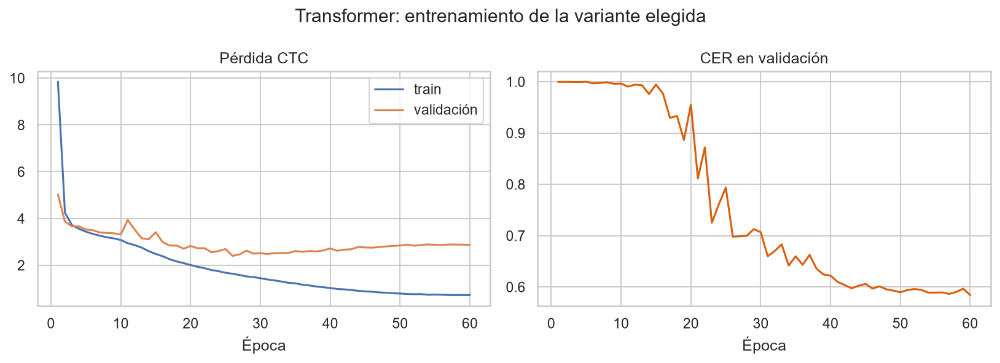
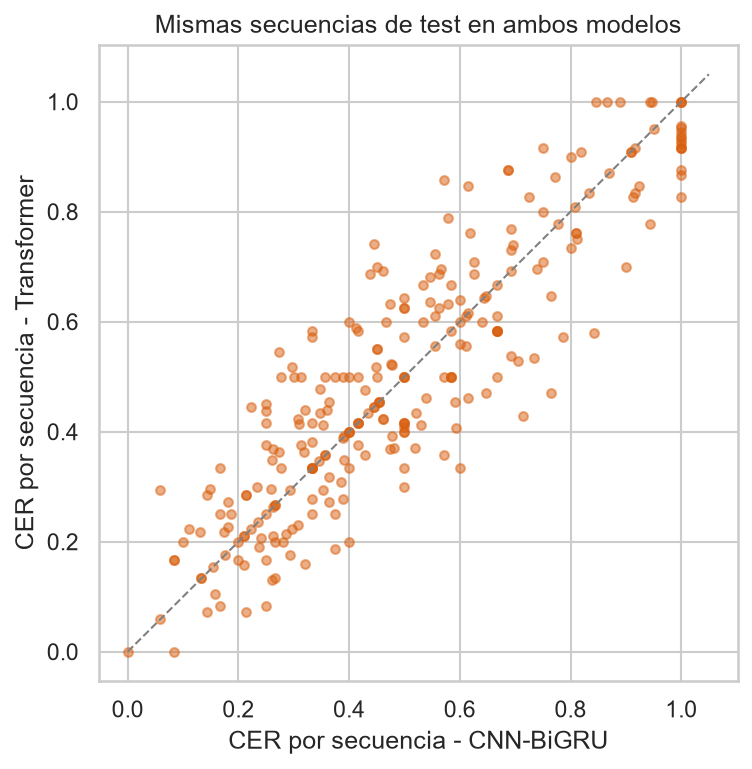
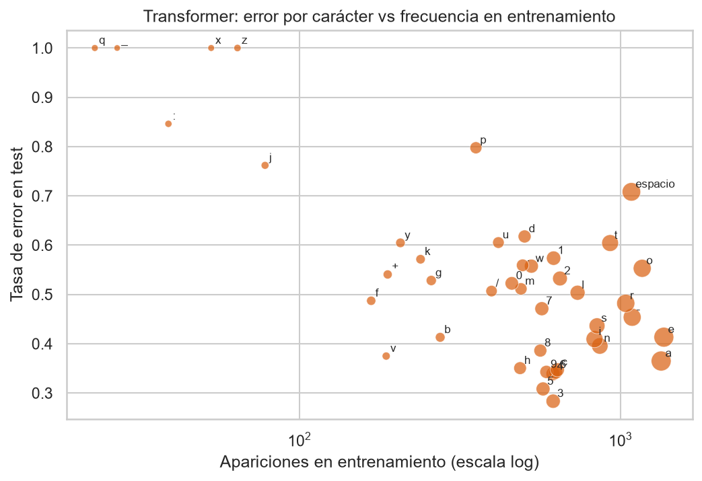

# Modelo de mayor techo: encoder Transformer + CTC

**Responsable principal:** María José Girón

> Sección del informe final para el modelo Transformer. Alimenta la Metodología (selección y arquitectura)
> y los Resultados (ajuste de parámetros, desempeño y comparación con el modelo principal). Detalle y código en
> [notebooks/10_modelo_transformer.ipynb](../notebooks/10_modelo_transformer.ipynb).

## Por qué se eligió

En la revisión bibliográfica, el Transformer quedó como el modelo de **mayor techo**: el mecanismo de atención
permite que cada cuadro se relacione directamente con cualquier otro de la secuencia, sin depender de un estado que
se arrastra paso a paso como en las redes recurrentes. Las mejores soluciones de la competencia usaron encoders de
este tipo. El riesgo es que necesita muchos datos, así que se probó una versión pequeña adaptada al volumen del
proyecto:

| Hallazgo | Decisión de diseño | Fuente |
|----------|--------------------|--------|
| Coarticulación: la forma de una letra depende de las vecinas | *Self-attention*: cada cuadro mira toda la secuencia en una sola capa | Vaswani et al. (2017) |
| Secuencias con mediana de 147 cuadros y cola hasta ~750 (recortadas a 384) | Convolución con *stride* **antes** de la atención: su costo crece con el cuadrado del largo, así que acortar la secuencia la abarata | Gulati et al. (2020) |
| Las letras se distinguen por movimientos de pocos cuadros | La convolución (kernel de 5 cuadros) capta esos patrones locales, que la atención sola capta peor | Gulati et al. (2020) |
| El orden de los cuadros importa y la atención no lo conoce | Codificación posicional sinusoidal, sin parámetros adicionales | Vaswani et al. (2017) |
| Solo 1,315 secuencias de entrenamiento y cómputo en CPU | Encoder pequeño (3 capas, dimensión 128) con normalización previa (*pre-norm*), más estable al entrenar | Xiong et al. (2020) |
| La etiqueta es la frase completa, sin alineación cuadro-letra | Pérdida CTC | Graves et al. (2006) |

## Arquitectura

La entrada es la misma de todos los modelos: 227 valores por cuadro (manos centradas en la muñeca, pose centrada en
los hombros y la máscara de detección de cada mano). Dos bloques convolucionales sobre el tiempo, el primero con
*stride* 2, reducen la secuencia a la mitad y la proyectan a 128 dimensiones; después de cada uno se pone en cero el
relleno de las secuencias cortas para que no contamine a los últimos cuadros reales. Se suma la codificación
posicional y la secuencia pasa por un encoder Transformer de 3 capas con 4 cabezas de atención, que recibe una
máscara para ignorar el relleno. Una capa lineal da la probabilidad de los 59 caracteres más el *blank* de CTC en
cada cuadro, y la frase se obtiene con la misma decodificación *greedy* que los demás modelos.

Se verificó que una secuencia procesada sola y dentro de un lote con relleno da la misma salida (diferencia máxima
de 1.2 × 10⁻⁶) y que el modelo puede memorizar un lote completo (pérdida CTC de 13.4 a 0.005), antes de entrenarlo.

Para el *stride* se revisó cuántas secuencias de entrenamiento siguen siendo alineables por CTC: con *stride* 2, el
95.5 % (la atención cuesta la cuarta parte), y con *stride* 4, el 92.5 % (cuesta la dieciseisava parte).

## Entrenamiento y ajuste de parámetros

Se usó el mismo protocolo que el modelo principal: mismos datos y split por participante, semilla 42, AdamW con
*one-cycle* (que incluye un calentamiento del *learning rate*, importante en Transformers), recorte de gradiente y
*early stopping* por CER de validación, con un máximo de 60 épocas. La configuración base fue dimensión 128,
4 cabezas, 3 capas, capa *feed-forward* de 256, *stride* 2, *dropout* 0.3 y *learning rate* 0.001, y se cambió un
hiperparámetro a la vez:

| Variante | Cambio | Parámetros | CER validación | Tiempo (min) |
|----------|--------|-----------:|---------------:|-------------:|
| dropout_0.1 | *dropout* 0.1 | 633,404 | **0.584** | 17.8 |
| stride_4 | *stride* 4 | 633,404 | 0.588 | 7.5 |
| mas_ancho | dimensión 192, *feed-forward* 384 | 1,306,428 | 0.626 | 19.6 |
| lr_3e-3 | *learning rate* 0.003 | 633,404 | 0.640 | 19.2 |
| mas_capas | 6 capas | 1,030,844 | 0.654 | 36.0 |
| base | — | 633,404 | 0.680 | 19.8 |

El factor limitante fue la **velocidad de aprendizaje, no la capacidad**: en 60 épocas la configuración base todavía
no convergía, y lo que más ayudó fue lo que acelera el aprendizaje (menos *dropout* o un *learning rate* mayor),
mientras que hacer el modelo más ancho o más profundo ayudó poco y costó más tiempo. Con *stride* 4 se obtuvo
prácticamente el mismo CER que la mejor variante en menos de la mitad del tiempo, igual que en el CNN-BiGRU. Se
eligió la variante con *dropout* 0.1 por su menor CER de validación; el conjunto de prueba solo se usó al final.

Las curvas de la variante elegida muestran sobreajuste: la pérdida de entrenamiento baja hasta 0.72 mientras la de
validación sube desde la época ~30, y el CER de validación se estanca en ~0.59 desde la época 45.

## Resultados en prueba y comparación con el modelo principal

| Métrica | Transformer | CNN-BiGRU |
|---------|------------:|----------:|
| CER en prueba | 0.499 | 0.490 |
| Métrica de Kaggle (1 − CER) | 0.501 | 0.510 |
| CER en validación | 0.584 | 0.552 |
| Parámetros | 0.63 M | 1.70 M |
| Tiempo de entrenamiento (CPU) | 17.8 min | 47.7 min |
| Tiempo de predicción | 1.8 ms por secuencia | 5.3 ms por secuencia |

Los dos modelos quedan **prácticamente empatados** en error: sobre las mismas 268 secuencias de prueba, el
Transformer acierta mejor en 103, peor en 105 y empata en 60, y la diferencia no es estadísticamente significativa
(prueba de Wilcoxon pareada, p = 0.21). Pero el Transformer lo logra con poco más de un tercio de los parámetros,
menos de la mitad del tiempo de entrenamiento y la tercera parte del tiempo de predicción, por lo que es el más
eficiente de los dos.

El análisis de errores repite los hallazgos del EDA:

- **Faltantes de mano:** la cobertura de mano sigue siendo lo que más explica el error de cada secuencia (Spearman
  de −0.74 con el CER).
- **Desbalance de caracteres:** los caracteres raros en entrenamiento se fallan más (Spearman de −0.50); q, x y z se
  fallan siempre. Los dígitos se aciertan algo mejor que las letras (tasa de error de 0.41 contra 0.49), y los mejores
  casos son números de teléfono transcritos sin errores.
- **Velocidad de deletreo:** el cuartil más rápido tiene CER de 0.644, contra 0.41-0.44 de los dos más lentos.
- **Tipo de error:** domina el borrado de letras (68 %), aunque menos que en el CNN-BiGRU (76 %); a cambio, el
  Transformer sustituye más (28 % contra 22 %), es decir, se arriesga a emitir más caracteres.

En conclusión, con 1,315 secuencias el Transformer **no superó** al modelo principal, pero lo **igualó con mucho menor
costo**. Su ventaja teórica (contexto global) necesita más datos para notarse: el límite lo pone el tamaño del
conjunto de entrenamiento, como muestra el sobreajuste. Las mejoras más directas son la aumentación de datos, usar más
archivos de la competencia y combinar las dos variantes que mejor funcionaron (*dropout* 0.1 y *stride* 4) con un
*learning rate* mayor.

## Referencias

Graves, A., Fernández, S., Gomez, F., & Schmidhuber, J. (2006). Connectionist temporal classification: Labelling unsegmented sequence data with recurrent neural networks. In *Proceedings of the 23rd International Conference on Machine Learning* (pp. 369–376). https://www.cs.toronto.edu/~graves/icml_2006.pdf

Gulati, A., Qin, J., Chiu, C.-C., Parmar, N., Zhang, Y., Yu, J., Han, W., Wang, S., Zhang, Z., Wu, Y., & Pang, R. (2020). Conformer: Convolution-augmented Transformer for speech recognition. In *Proceedings of Interspeech 2020* (pp. 5036–5040). https://doi.org/10.21437/Interspeech.2020-3015

Henkel, C. (2023). *1st place solution to the Google – American Sign Language Fingerspelling Recognition competition* [Repositorio de código]. GitHub. https://github.com/ChristofHenkel/kaggle-asl-fingerspelling-1st-place-solution

Vaswani, A., Shazeer, N., Parmar, N., Uszkoreit, J., Jones, L., Gomez, A. N., Kaiser, Ł., & Polosukhin, I. (2017). Attention is all you need. In *Advances in Neural Information Processing Systems 30* (pp. 5998–6008). https://arxiv.org/abs/1706.03762

Wilcoxon, F. (1945). Individual comparisons by ranking methods. *Biometrics Bulletin, 1*(6), 80–83. https://doi.org/10.2307/3001968

Xiong, R., Yang, Y., He, D., Zheng, K., Zheng, S., Xing, C., Zhang, H., Lan, Y., Wang, L., & Liu, T.-Y. (2020). On layer normalization in the Transformer architecture. In *Proceedings of the 37th International Conference on Machine Learning* (pp. 10524–10533). PMLR. https://arxiv.org/abs/2002.04745
