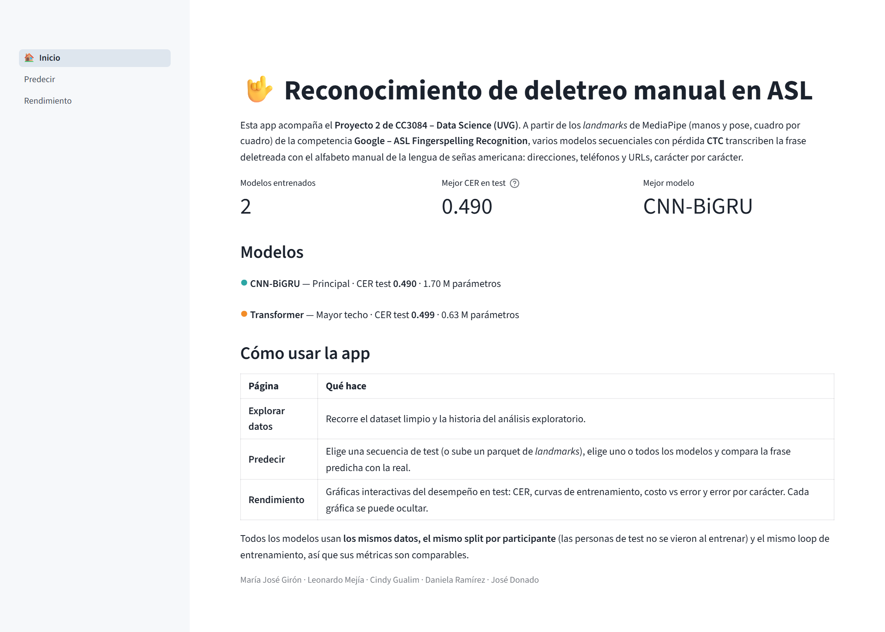
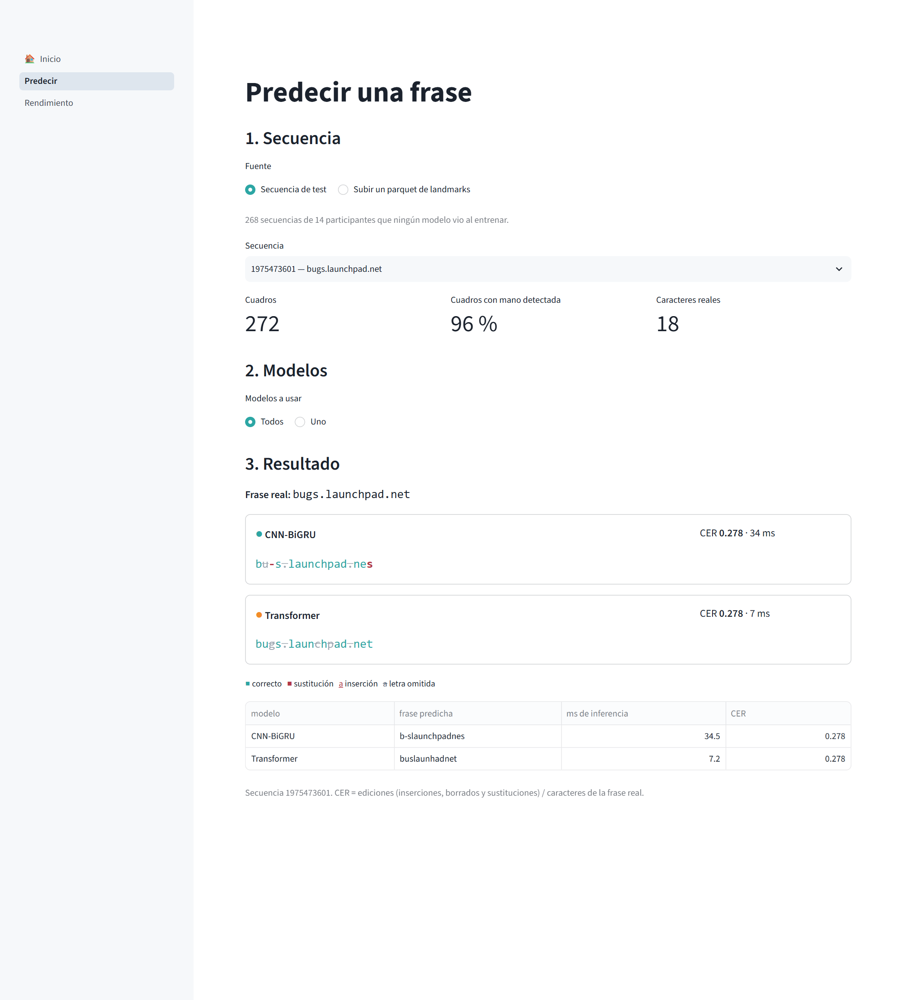
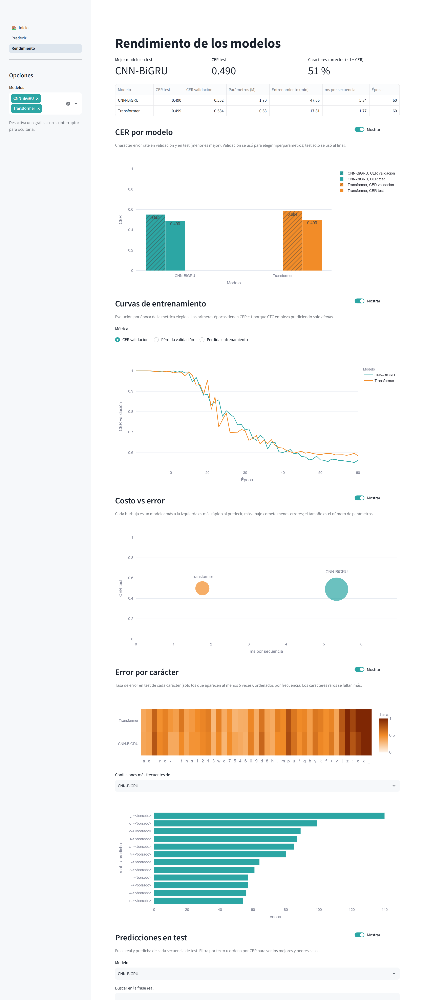

# Aplicación web de resultados

**Responsable principal:** María José Girón

> Sección del informe final con la descripción de la app y la justificación de las tecnologías. Código en
> [app/](../app/); se ejecuta con `streamlit run app/app.py` desde la raíz del repositorio.

## Propósito

La app permite que cualquier persona, sin abrir los notebooks, vea el resultado del proyecto de tres formas:
explorar los datos, poner a prueba los modelos con secuencias concretas y comparar su rendimiento. Solo **lee** los
archivos que deja el entrenamiento (`models/<modelo>.pt` y `reports/metrics/<modelo>.json`), así que cada modelo
nuevo que el equipo guarda con `train.guardar_resultados` aparece en la app sin cambiar su código.

## Páginas

### Inicio

Presenta el problema, los modelos entrenados con su papel en el proyecto (principal, mayor techo, línea base,
variante) y su CER en el conjunto de prueba, y explica qué hace cada página.

### Predecir

1. **Secuencia:** se elige una de las 268 secuencias de prueba (14 participantes que ningún modelo vio al
   entrenar) o se sube un archivo parquet de *landmarks* con el formato de la competencia. Un archivo subido pasa
   por el mismo preprocesamiento que los datos de entrenamiento (normalización respecto a la muñeca, máscara de
   detección y *forward-fill*), sin que el usuario tenga que hacer nada. Se muestran el número de cuadros, el
   porcentaje de cuadros con mano detectada y un aviso si la secuencia está por debajo del umbral de 10 % que se
   usó en la limpieza.
2. **Modelos:** uno solo o todos a la vez.
3. **Resultado:** la frase real y, por modelo, la frase predicha con cada carácter coloreado según la alineación
   de mínima edición (correcto, sustituido, insertado u omitido), su CER y el tiempo de inferencia. Así se ve de
   inmediato *qué tipo* de error comete cada modelo, no solo cuánto se equivoca.

### Rendimiento

Gráficas **interactivas** del desempeño en prueba (zoom, *hover* con los valores exactos y leyendas para aislar
modelos). Cada gráfica tiene un interruptor para **ocultarla**, y en la barra lateral se eligen los modelos que se
comparan:

| Gráfica | Pregunta que responde |
|---------|-----------------------|
| CER por modelo (validación y prueba) | ¿Qué modelo comete menos errores y generaliza a personas nuevas? |
| Curvas de entrenamiento (CER o pérdida por época) | ¿Cómo aprendió cada modelo y cuándo dejó de mejorar? |
| Costo vs. error (ms por secuencia vs. CER, tamaño = parámetros) | ¿Cuánto cuesta cada punto de mejora? |
| Mapa de calor de error por carácter + confusiones más frecuentes | ¿Qué letras falla cada modelo y con cuáles las confunde? |
| Tabla de predicciones de prueba con búsqueda | ¿En qué frases concretas acierta o falla? |

## Diseño visual y uso del color

- **Un color fijo por modelo** en todas las páginas y gráficas, para que la persona lo asocie sin volver a leer la
  leyenda. La paleta parte de los colores de la presentación (azul marino, *teal* y naranja): los dos modelos
  centrales usan un par **complementario** (CNN-BiGRU en *teal* y Transformer en naranja) para que contrasten al
  máximo, y el resto se reparte en el círculo cromático con luminosidad parecida para que ningún modelo destaque
  sin razón. Se evitó el par rojo-verde para que la paleta funcione también con daltonismo.
- Las magnitudes (tasa de error por carácter) usan una **escala secuencial de un solo tono**, de claro (poco error)
  a oscuro (mucho error), en lugar de una escala de colores categóricos que sugeriría un orden falso.
- Los errores dentro de la frase predicha usan un rojo oscuro distinto de los colores de los modelos, para que no se
  confundan con un modelo.

## Tecnologías y por qué

| Tecnología | Uso | Por qué |
|------------|-----|---------|
| **Streamlit** | Estructura de la app, páginas y controles | Permite construir la app en Python puro reutilizando directamente el código del proyecto (`src/features`, `src/metrics`, `src/train`), sin una API intermedia ni código de *frontend*. El sistema de páginas permite que cada integrante trabaje en su propio archivo sin conflictos, y su caché (`st.cache_data`, `st.cache_resource`) evita recargar métricas y modelos en cada interacción. |
| **Plotly** | Gráficas de rendimiento | Gráficas interactivas (zoom, *hover*, ocultar series desde la leyenda) que se integran de forma nativa en Streamlit, y que sustituyen a las figuras estáticas de matplotlib de los notebooks. |
| **PyTorch** | Inferencia | Es el mismo framework del entrenamiento: los modelos se reconstruyen con `src/models/<modelo>.py` y sus pesos guardados, y se predice en CPU en pocos milisegundos por secuencia. |
| **pandas / pyarrow** | Lectura de parquet y tablas | Mismo formato de datos que la competencia y que el resto del proyecto. |

Las alternativas consideradas fueron Dash (más control sobre el diseño, pero requiere más código de
*callbacks* para el mismo resultado) y una app con un *frontend* web aparte (más trabajo y una API que mantener).
Para una app de análisis con un equipo de cinco personas y una semana de desarrollo, Streamlit da el mejor
equilibrio entre rapidez y resultado.
