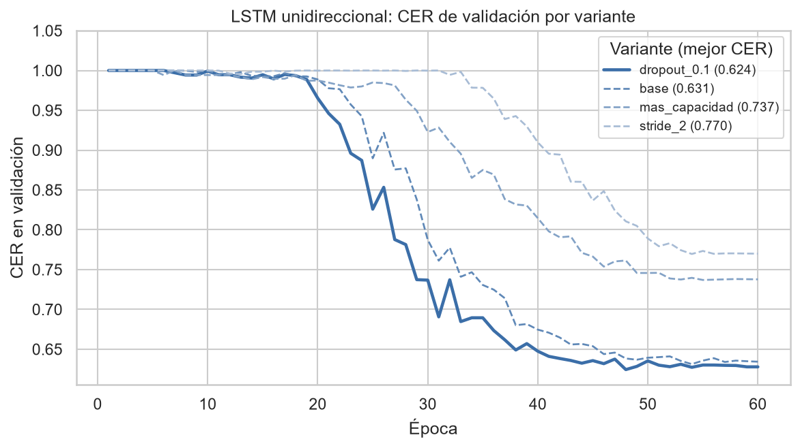
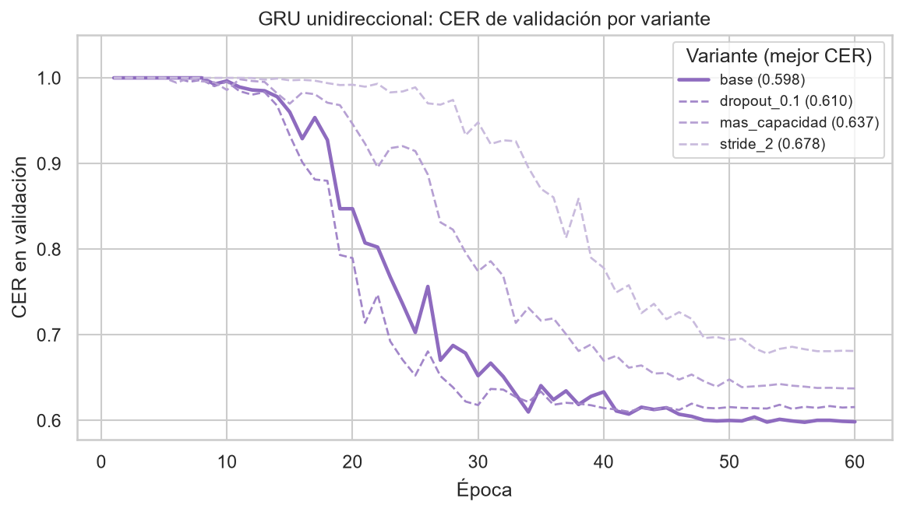
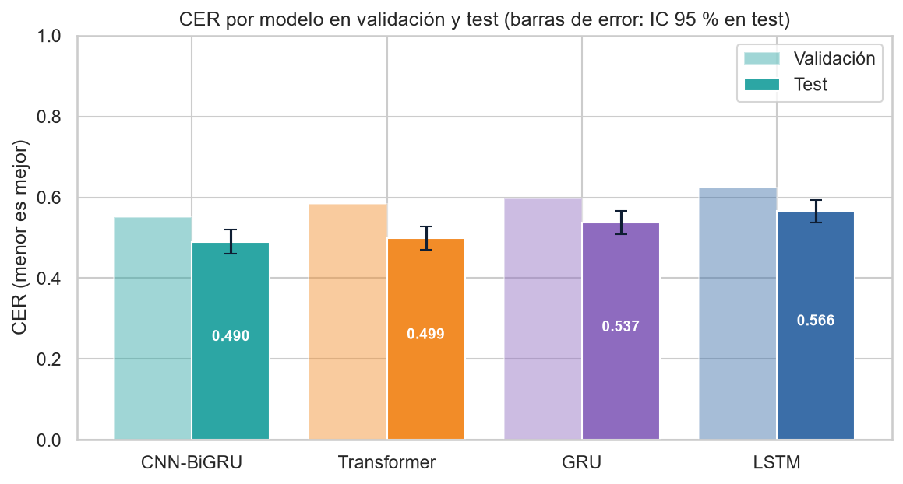
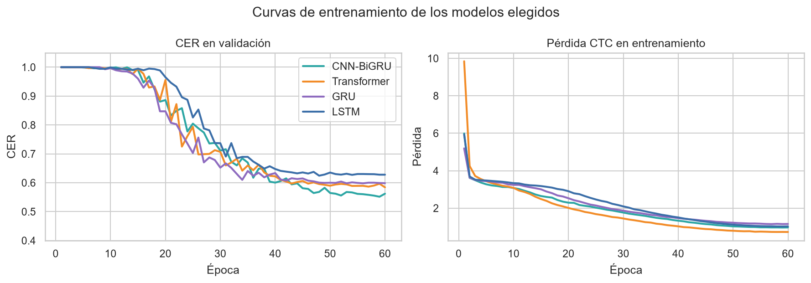
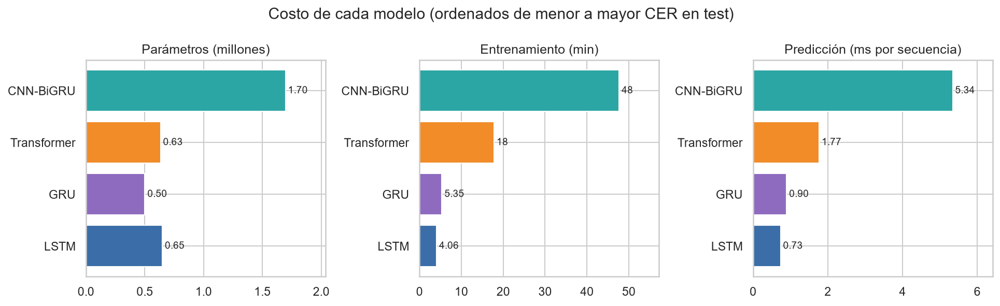
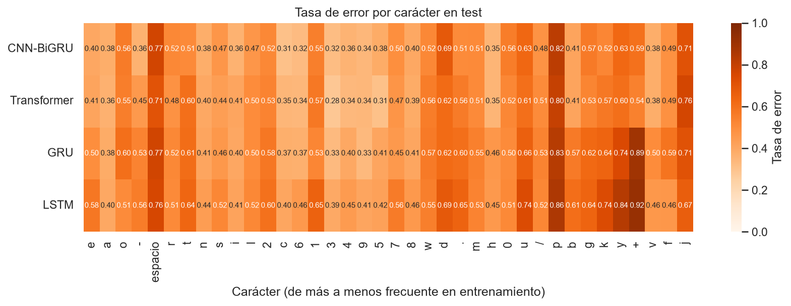
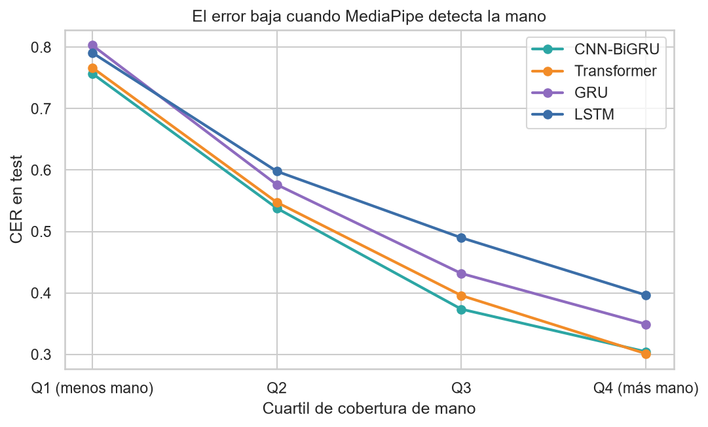

# Resultados y análisis: ajuste de parámetros y comparación de algoritmos

Responsable: Daniela Ramírez de León

Sección del informe final con el ajuste de parámetros de los cuatro modelos y su comparación. El código está en
notebooks/08_modelo_lstm.ipynb (línea base y ablación) y notebooks/11_comparacion_modelos.ipynb (comparación). El
detalle del modelo principal y del Transformer está en docs/05_modelo_cnn_bigru.md y docs/06_modelo_transformer.md.

## Protocolo común

Los cuatro modelos se entrenaron con los mismos datos (1,315 secuencias de entrenamiento, 295 de validación y 268 de
prueba, separadas por participante), el mismo preprocesamiento (227 valores por cuadro: manos y pose normalizadas más
la máscara de detección), la misma pérdida CTC con decodificación greedy, AdamW con one-cycle, semilla 42 y un máximo
de 60 épocas en la misma CPU. En cada modelo se cambió un hiperparámetro a la vez a partir de una configuración base,
se eligió la variante con menor CER de validación y solo al final se evaluó en prueba. La métrica es el CER (ediciones
por carácter de la frase real; menor es mejor), que equivale a 1 menos el score de la competencia de Kaggle.

## Línea base: LSTM unidireccional y GRU como ablación

La línea base es el modelo recurrente más simple que resuelve la tarea (Hochreiter y Schmidhuber, 1997; Graves et al.,
2006): una capa lineal que proyecta cada cuadro, un promedio cada cierto número de cuadros (stride) para acortar la
secuencia, una LSTM de dos capas que lee solo hacia adelante y una capa de salida con CTC. La GRU es una ablación:
misma arquitectura, cambiando solo la celda por una con dos compuertas en lugar de tres (Cho et al., 2014).

Una primera corrida con la configuración de los demás modelos (stride 2 y early stopping con paciencia de 10 épocas)
falló: la LSTM seguía prediciendo solo blanks después de 20 épocas y el early stopping la detuvo con CER de 1.0. Sin
early stopping llegó apenas a 0.836. Por eso, en la línea base se desactivó el early stopping (se conservan igual los
pesos de la época con menor CER de validación) y se tomó stride 4 como base, porque en esa misma corrida ya había
llegado a 0.631. Las variantes fueron las mismas para ambas celdas:

- base: 192 unidades, 2 capas, stride 4, dropout 0.3. LSTM 0.631, GRU 0.598.
- dropout 0.1. LSTM 0.624, GRU 0.610.
- más capacidad (256 unidades y 3 capas). LSTM 0.737, GRU 0.637.
- stride 2. LSTM 0.770, GRU 0.678.

Para la LSTM se eligió dropout 0.1 y para la GRU la base. Lo que más pesa en un modelo que solo lee hacia adelante es
el largo de la secuencia: con stride 2 la LSTM tardó más de 30 épocas en salir de la fase de blanks y no alcanzó a
converger en 60. Agregar capacidad empeoró el resultado en ambas celdas: con 1,315 secuencias, el modelo más grande
aprende más lento y no le alcanzan las épocas.

## Resumen del ajuste de los cuatro modelos

- CNN-BiGRU (principal): más capacidad (256 canales y 192 unidades) dio el menor CER de validación, 0.552. Con stride 4 se llegó a casi lo mismo (0.554) en un tercio del tiempo, y dropout 0.5 frenó el aprendizaje (0.797).
- Transformer (mayor techo): el límite fue la velocidad de aprendizaje, no la capacidad. Lo que más ayudó fue bajar el dropout a 0.1 (0.584); más capas o más ancho costaron más tiempo sin mejorar.
- LSTM (línea base): stride 4 y dropout 0.1 (0.624).
- GRU (ablación): stride 4 y dropout 0.3 (0.598).

En los cuatro modelos se repiten dos patrones: reducir el tiempo con stride 4 casi no cuesta error y ahorra mucho
cómputo, y hacer el modelo más grande no ayuda con tan pocas secuencias. El problema de este conjunto de datos es la
cantidad de ejemplos, no la capacidad de los modelos.

## Comparación de efectividad

Resultados en prueba, de mejor a peor (entre paréntesis el intervalo de confianza del 95 % por bootstrap de
secuencias):

- CNN-BiGRU: CER 0.490 (0.461 a 0.519), validación 0.552.
- Transformer: CER 0.499 (0.471 a 0.529), validación 0.584.
- GRU: CER 0.537 (0.509 a 0.566), validación 0.598.
- LSTM: CER 0.566 (0.538 a 0.594), validación 0.624.

Las 268 secuencias de prueba las predicen todos los modelos, así que se compararon por pares con la prueba de
Wilcoxon sobre el CER de cada secuencia. La única diferencia que no es significativa es la del CNN-BiGRU contra el
Transformer (p = 0.21): ambos empatan. Los dos le ganan a la GRU (p = 1e-9 y 1e-6) y a la LSTM (p = 1e-18 y 3e-14), y
la GRU le gana a la LSTM (p = 6e-6).

El CER de prueba es menor que el de validación en todos los modelos. No es un error: cada partición tiene solo 14
participantes, y los de prueba resultaron más fáciles para todos los modelos por igual (el orden entre modelos se
mantiene).

La comparación responde dos preguntas de diseño:

- ¿Sirve ver el contexto completo de cada letra? Sí. Los dos modelos que lo ven (la BiGRU en ambas direcciones y el Transformer con atención) le ganan a los dos que solo leen hacia adelante, por 5 a 8 puntos de CER. En el deletreo, la forma de una letra depende también de la siguiente (coarticulación), y un modelo unidireccional tiene que decidir sin esa información.
- ¿LSTM o GRU? Con la misma arquitectura, la GRU tiene 23 % menos parámetros y comete menos errores. Con pocos datos, la celda más simple generaliza mejor, en línea con Chung et al. (2014). Esto respalda la elección de una GRU en el modelo principal.

Las curvas de entrenamiento muestran por qué la LSTM queda atrás: es la que más tarda en salir de la fase en la que
CTC solo predice blanks (cerca de la época 20) y se estanca en un CER más alto. En los cuatro modelos el CER de
validación ya casi no baja en las últimas 10 épocas.

## Comparación de costo

- CNN-BiGRU: 1.70 M de parámetros, 48 minutos de entrenamiento, 5.3 ms por secuencia.
- Transformer: 0.63 M de parámetros, 18 minutos, 1.8 ms por secuencia.
- GRU: 0.50 M de parámetros, 5 minutos, 0.9 ms por secuencia.
- LSTM: 0.65 M de parámetros, 4 minutos, 0.7 ms por secuencia.

El Transformer logra el mismo error que el CNN-BiGRU con 37 % de sus parámetros, un tercio del tiempo de entrenamiento
y 3 veces menos tiempo por secuencia, así que es el de mejor relación entre error y costo. Las líneas base son las
más baratas (entrenan en 4 a 5 minutos porque con stride 4 la red recurrente recibe secuencias cuatro veces más
cortas), pero pagan ese ahorro con 5 a 8 puntos de CER. Todos predicen una secuencia en pocos milisegundos, por lo que
cualquiera sirve para la aplicación.

## Comparación de errores

Cada error se clasificó alineando la frase real con la predicha:

- CNN-BiGRU: 76 % borrados, 22 % sustituciones, 2 % inserciones.
- Transformer: 68 %, 28 % y 3 %.
- GRU: 67 %, 30 % y 3 %.
- LSTM: 62 %, 35 % y 4 %.

En todos dominan los borrados: cuando el modelo duda, CTC emite blank y se salta la letra. El CNN-BiGRU es el que más
borra y menos sustituye (es conservador: si emite una letra, suele acertar), mientras que las líneas base emiten más
letras pero se equivocan más de letra.

El error por carácter refleja el desbalance de caracteres del análisis exploratorio: en los cuatro modelos, los
caracteres más frecuentes en entrenamiento se fallan menos (correlación de Spearman entre frecuencia y tasa de error
de -0.27 a -0.44). Los caracteres poco frecuentes, como la j y la p, se fallan en dos de cada tres casos o más en todos
los modelos (la p en más del 80 %), y el espacio también se falla mucho (71 a 77 %), porque en el deletreo no tiene una seña propia y solo se marca con
una pausa.

El hallazgo del análisis exploratorio que más pesa es el de los faltantes de mano. Al agrupar las secuencias de
prueba por cuartil de cobertura de mano (proporción de cuadros en los que MediaPipe detectó al menos una mano), todos
los modelos tienen un CER cercano a 0.8 en el cuartil con menos mano y bajan a entre 0.30 y 0.40 en el cuartil con
más mano. La diferencia entre cuartiles (unos 45 puntos) es mucho mayor que la diferencia entre modelos (unos 8
puntos): la calidad de la detección limita a todas las arquitecturas por igual.

## Selección de modelos

- Para la aplicación conviene el Transformer: empata en error con el mejor modelo y es el más barato de los dos.
- El CNN-BiGRU queda como el modelo de menor error, por si solo importa la precisión.
- La LSTM y la GRU se mantienen en la aplicación como referencia: muestran cuánto aporta el contexto completo.
- Para mejorar cualquiera de los modelos, lo que más rendiría según estos resultados es más datos (aquí se usaron 2 de los 68 archivos de la competencia) y una mejor cobertura de mano, más que una arquitectura más grande.

## Referencias

Cho, K., van Merriënboer, B., Gulcehre, C., Bahdanau, D., Bougares, F., Schwenk, H., & Bengio, Y. (2014). Learning phrase representations using RNN encoder–decoder for statistical machine translation. In Proceedings of the 2014 Conference on Empirical Methods in Natural Language Processing (pp. 1724–1734). Association for Computational Linguistics. https://aclanthology.org/D14-1179

Chung, J., Gulcehre, C., Cho, K., & Bengio, Y. (2014). Empirical evaluation of gated recurrent neural networks on sequence modeling. arXiv. https://arxiv.org/abs/1412.3555

Graves, A., Fernández, S., Gomez, F., & Schmidhuber, J. (2006). Connectionist temporal classification: Labelling unsegmented sequence data with recurrent neural networks. In Proceedings of the 23rd International Conference on Machine Learning (pp. 369–376). https://doi.org/10.1145/1143844.1143891

Hochreiter, S., & Schmidhuber, J. (1997). Long short-term memory. Neural Computation, 9(8), 1735–1780. https://doi.org/10.1162/neco.1997.9.8.1735
